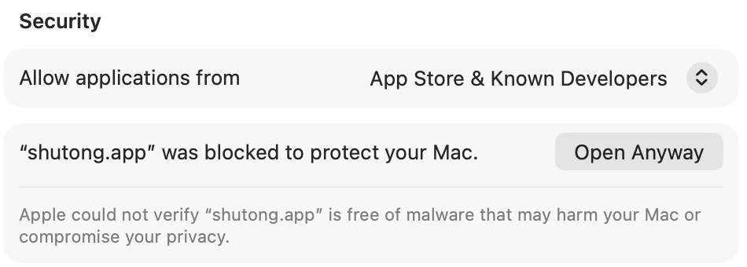
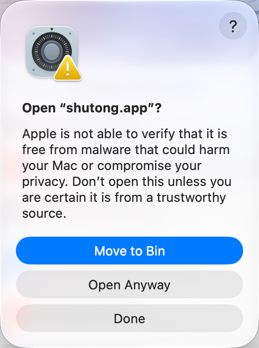
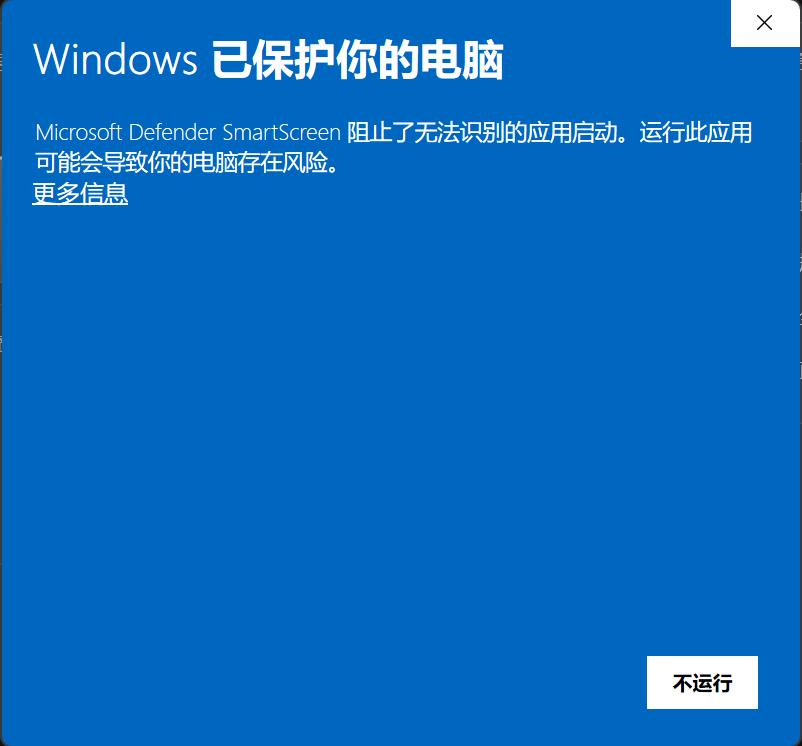
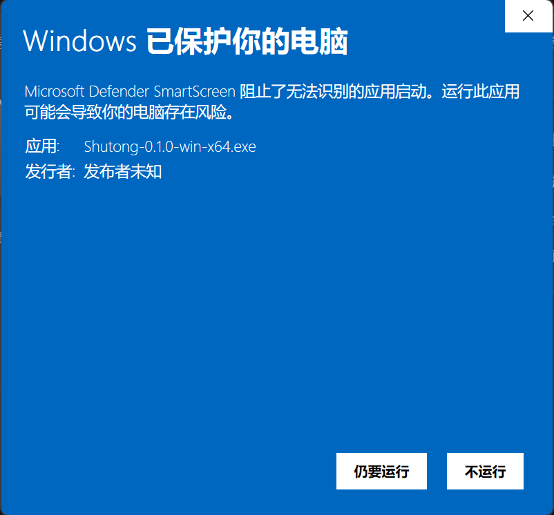
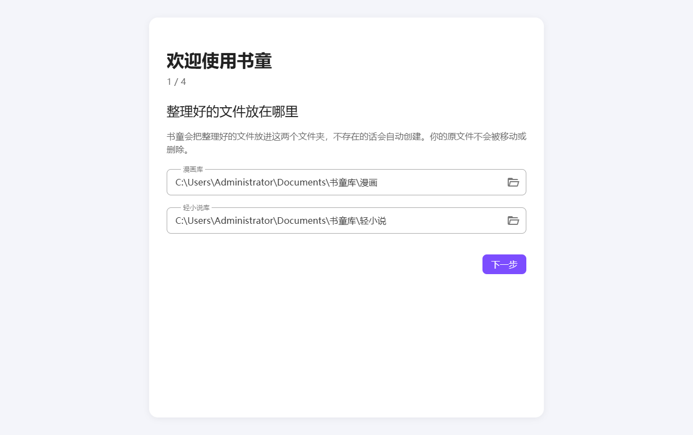

# 书童

把电脑上乱七八糟的漫画和轻小说拖进窗口，书童会用 AI 认出书名和卷号，到 Bangumi 查资料，整理成整齐的库。

- 支持漫画的 zip、cbz、rar、cbr、7z、cb7、pdf 和图片文件夹，轻小说的 epub
- 原文件默认留在原处，确认没问题后再由你决定是否移进回收站
- 不需要 NAS 或媒体服务器

**需要准备：** 一个兼容 OpenAI 的 AI 接口（自己申请，会产生少量费用）。没有它就不能整理。

## 下载

到 [Releases](../../releases/latest) 下载：

| 你的电脑 | 下载 |
|---|---|
| Windows 10 或更新 | `Shutong-版本号-win-x64.exe` |
| Mac，M 系列芯片，macOS 13 或更新 | `Shutong-版本号-mac-arm64.dmg` |
| Mac，Intel 芯片，macOS 13 或更新 | `Shutong-版本号-mac-x64.dmg`（**未在真机上实测**，只通过了自动测试，遇到问题欢迎反馈） |

不确定 Mac 是哪种芯片：点屏幕左上角苹果图标 →「关于本机」，看「芯片」或「处理器」那一行。

## 为什么会弹安全警告

书童没有购买苹果和微软的开发者证书，系统认不出发布者，所以第一次打开时会警告。**这不代表文件有问题**，但也说明系统无法替你确认来源，所以请只从这个页面下载。想再确认一下的话，可以[核对校验值](#核对校验值)。

## macOS 安装

1. 打开 dmg，把 `shutong` 拖进「应用程序」文件夹。
2. 在「应用程序」里双击 `shutong`。系统提示无法验证，点「完成」关掉提示。
3. 打开「系统设置 → 隐私与安全性」，滚动到「安全性」一栏，点 `shutong` 旁边的「仍要打开」。下图是英文系统，按钮显示为 `Open Anyway`：

   

4. 系统会再弹一个确认窗口，点中间的「仍要打开」（`Open Anyway`），然后输入开机密码或用 Touch ID。**最上面蓝色的按钮是移到废纸篓，不要点错：**

   

5. 之后就可以正常打开了。**安装新版本后，要再做一次第 2 到 4 步。**

## Windows 安装

1. 双击下载的 exe。出现「Windows 已保护你的电脑」时，先点「更多信息」：

   

2. 核对应用名是 `Shutong-版本号-win-x64.exe`，发布者显示「发布者未知」是正常的，点「仍要运行」：

   

3. 在安装程序里选「仅为我安装」，一路点下一步。这个选项不需要管理员权限。

**杀毒软件报毒或删除文件：** 这类没有证书、由 Python 打包的程序偶尔会被误报。先[核对校验值](#核对校验值)，一致的话把 shutong 的安装目录加入杀毒软件的信任列表。

## 第一次使用

1. **选库目录：** 整理好的文件放在这里，默认在「文档/书童库」。
2. **配置 AI：** 填接口地址、API Key 和模型名，保存后测试连接。
   **文件名、目录名，以及 EPUB 里的书名和作者会发给你配置的 AI 服务商；文件内容不会发送。**
3. **Bangumi 令牌：** 可以跳过。
4. 把文件或文件夹拖进窗口，选放进漫画库还是轻小说库。

AI 有把握的会直接入库；没把握的会放进「复核」，等你确认。整理后，原文件仍然留在原处，所以**硬盘要有足够空间放下另一份**。

## 更新

有新版本时，书童会在窗口顶部提示，点击后到这个页面下载，覆盖安装即可，数据不会丢。

## 卸载

- **macOS：** 把「应用程序」里的 `shutong` 移进废纸篓。
- **Windows：** 在「设置 → 应用」里卸载。

卸载不会删除你的库和原文件。书童自己的数据（设置、记录、日志，其中包括你的 AI 密钥）想一起清掉的话，手动删除下面的目录：

- **macOS：** `~/Library/Application Support/shutong`
- **Windows：** `%APPDATA%\shutong`

Windows 卸载后还会留下一份安装缓存（约 145 MB），可以直接删除：`%LOCALAPPDATA%\shutong-desktop-updater`。

## 核对校验值

每个版本的 Releases 里都有 `SHA256SUMS.txt`。

- **macOS 终端：** `shasum -a 256 下载的文件`
- **Windows PowerShell：** `Get-FileHash 下载的文件`

算出来的值和 `SHA256SUMS.txt` 里的一致，就说明文件和发布的是同一个。

## 遇到问题

菜单「帮助 → 打开日志目录」里有日志。提问时请附上日志，但先检查有没有你不想公开的文件名。
