# 书童使用教程

安装见 [README](../README.md)。这里讲装好之后怎么用：配置、建库、整理、复核，以及命名模板和媒体服务器联动。

- [1. 先配置 AI 和元数据源](#1-先配置-ai-和元数据源)
- [2. 建库](#2-建库)
- [3. 整理](#3-整理)
- [4. 复核](#4-复核)
- [5. 整理历史](#5-整理历史)
- [6. 命名模板](#6-命名模板)
- [7. 联动 Kavita / Komga](#7-联动-kavita--komga)
- [8. 常见问题](#8-常见问题)

## 1. 先配置 AI 和元数据源

### AI（必填）

书童靠 AI 从文件名和目录名认出书名、版本和卷号，没配 AI 不能整理。兼容 OpenAI 接口的服务都可以用，**推荐 DeepSeek 官方**：

1. 打开 [DeepSeek 开放平台](https://platform.deepseek.com)，用手机号登录。没注册过的手机号会自动注册。

   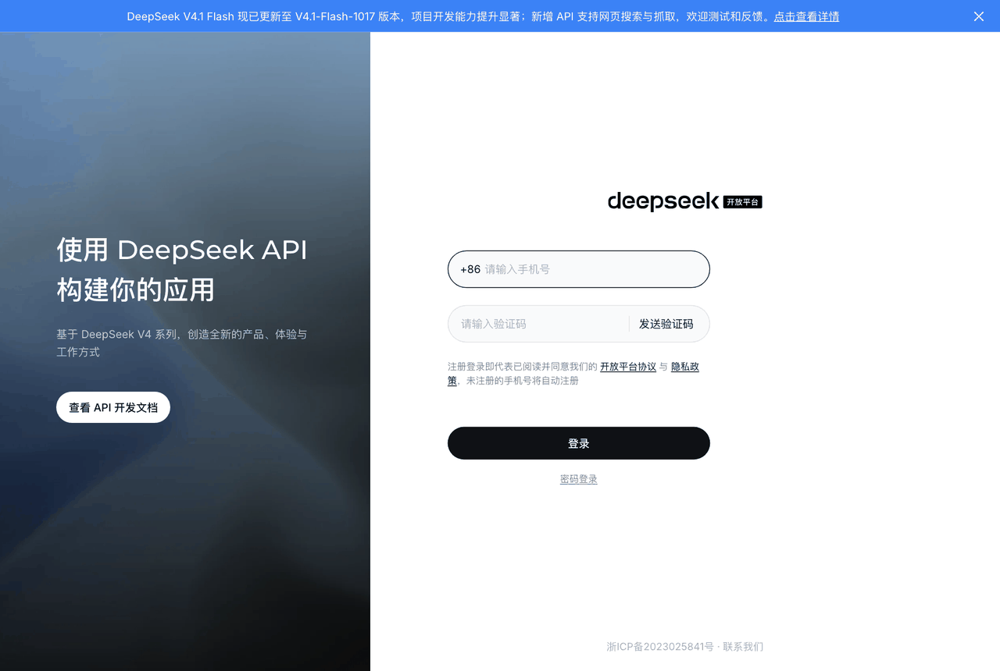

2. 在左侧「充值」里充一点钱。按用量计费，整理一本书只用很少的量，可以先少充一些试试。
3. 在左侧「API keys」里点「创建 API key」，起个名字（如「书童」），复制生成的 key。**key 只显示这一次**，先存好。
4. 回到书童，打开「设置 → AI」，填：

   | 项 | 填什么 |
   |----|--------|
   | 接口地址 | `https://api.deepseek.com` |
   | API Key | 刚才复制的 key |
   | 模型 | `deepseek-flash` |

   保存后点「测试连接」，显示连接成功就好了。

   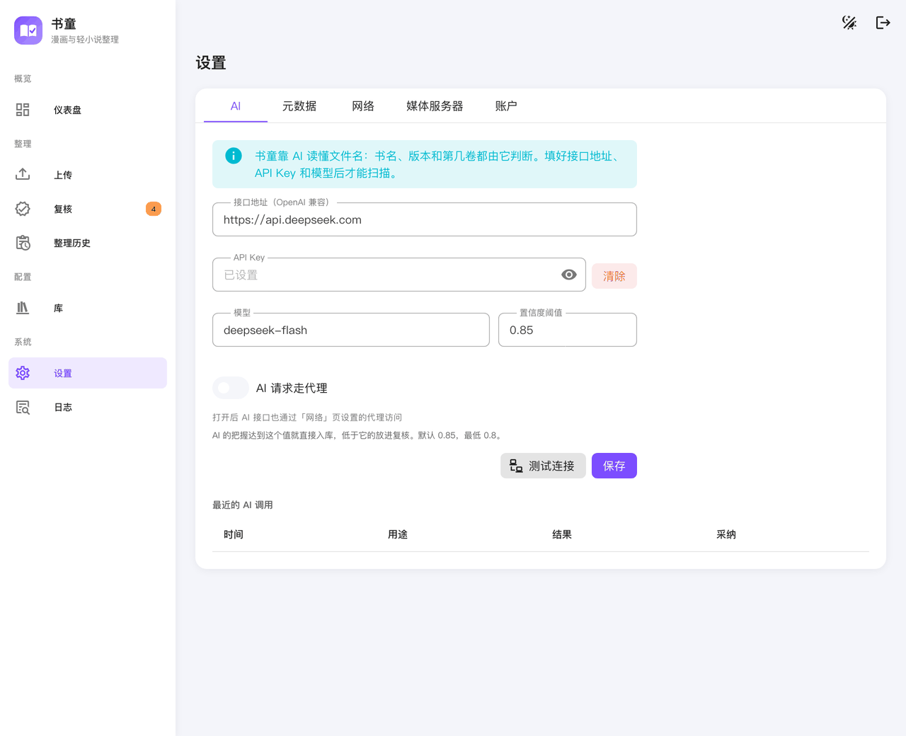

也可以用第三方中转站，比如 [米醋 API](https://www.micuapi.ai/sign-up?aff=eK4Y)。填它给的接口地址、令牌和模型名即可。

> 文件名、目录名，以及 EPUB 里的书名和作者会发给你配置的 AI 服务商；文件内容不会发送。

「设置 → AI」下方的「最近的 AI 调用」列出了每次调用，可以看到用了多少次。

### 置信度阈值

 AI 的把握达到这个值就直接入库，低于它的进复核等你确认。默认 0.85，最低 0.8。调高会更谨慎，复核也更多。

### 元数据源

「设置 → 元数据」里决定从哪里查简介、作者、出版社等资料。

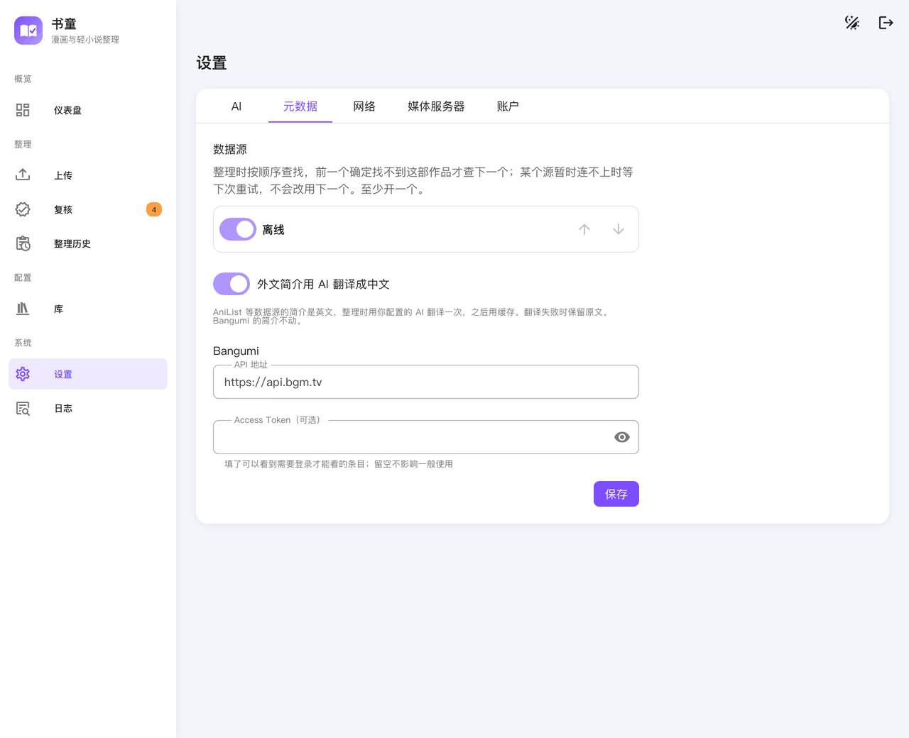

- 默认只用 Bangumi，中文书名和简介最全。
- 可以再打开 AniList，用来补 Bangumi 上没有的作品。AniList 按日文或英文原名查找，简介是英文。
- 用上下箭头调整顺序。整理时按顺序查：前一个源确定没有这部作品，才去查下一个；某个源暂时连不上时，条目会等下次重试，不会改用下一个源。
- 同一个目录里的书，一旦用某个源整理过，之后的新卷也用这个源，不会一半 Bangumi 一半 AniList。
- 「外文简介用 AI 翻译成中文」默认打开：AniList 的英文简介整理时会用你配置的 AI 翻译一次，之后用缓存；翻译失败时保留原文。

### 网络（可选）

访问 Bangumi 或 AniList 需要代理时，在「设置 → 网络」里填代理地址。

连不上 Bangumi 官方时，也可以用镜像站：在「设置 → 元数据」的 Bangumi 部分，

- 「API 地址」填 API 镜像，代替 `https://api.bgm.tv`；
- 「图片地址」填图片镜像，代替官方图片服务器 `https://lain.bgm.tv`。留空的话，封面用 API 返回的地址；有些 API 镜像已经把图片指向了自己的图片镜像，这时图片地址可以不填。

## 2. 建库

一个库对应一类书：漫画库或轻小说库。在「库」页点「新建库」，已有的库点右上角的箭头展开设置。

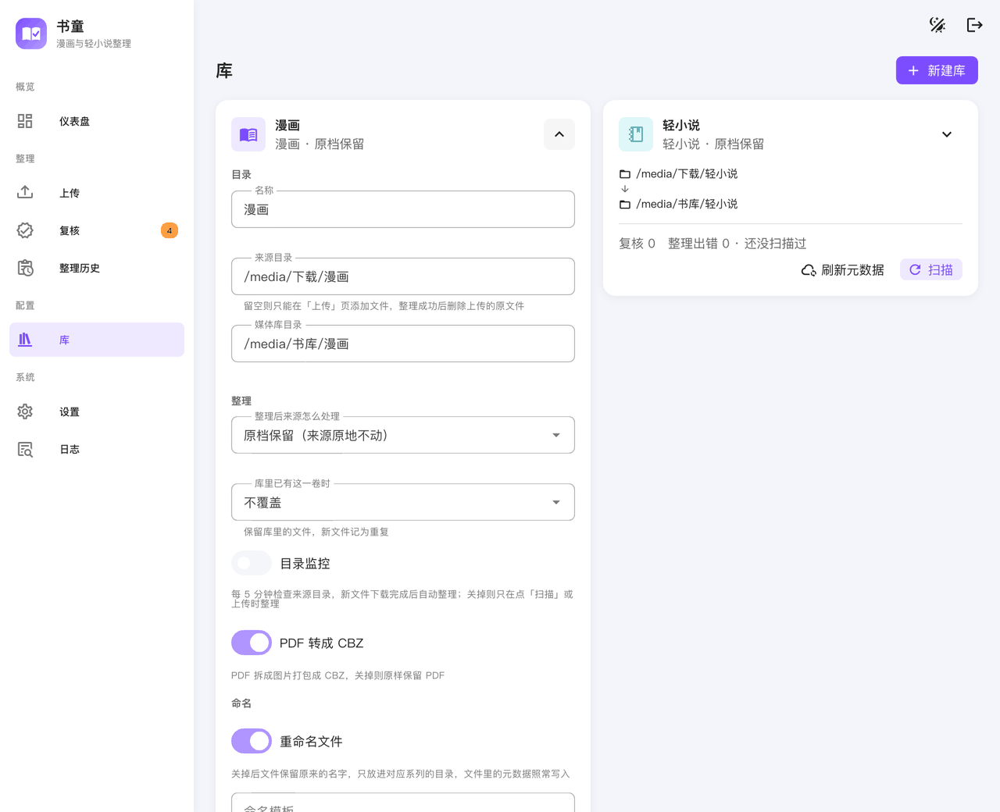

| 设置 | 说明 |
|------|------|
| 来源目录 | 下载好的、待整理的文件放在这里。留空的话，只能在「上传」页添加文件 |
| 媒体库目录 | 整理好的文件放在这里，Kavita / Komga 读的就是这个目录 |
| 整理后来源怎么处理 | 原档保留（不动）、移到原档目录、整理后删除原档 |
| 库里已有这一卷时 | 不覆盖、总是覆盖、留大的、保留最新。除「不覆盖」外，被替换的旧文件会被删除 |
| 重命名文件 | 关掉后文件保留原名，只放进对应系列的目录 |
| PDF 转成 CBZ | 漫画库可选，把 PDF 拆成图片打包成 CBZ |
| 目录监控 | Docker 版可选，每 5 分钟检查来源目录，新文件下载完自动整理 |
| 命名模板 | 整理后的文件放在哪、叫什么，见[第 6 节](#6-命名模板) |
| 媒体服务器 | 整理完通知 Kavita / Komga 扫描，见[第 7 节](#7-联动-kavita--komga) |

桌面版第一次打开时会自动建好「漫画库」和「轻小说库」两个库。

### 删除的文件去哪了

有几种操作会删掉文件：「整理后删除原档」、覆盖库里已有的卷、「重新整理」时删掉库里的旧文件。

- **桌面版：** 这些文件都会移进系统回收站，可以找回。
- **Docker 版（NAS）：** 直接删除，不可恢复。所以在库设置里选「整理后删除原档」或覆盖方式时，会先弹窗确认；「重新整理」的对话框里也有醒目提示。

## 3. 整理

有三种方式把文件交给书童：

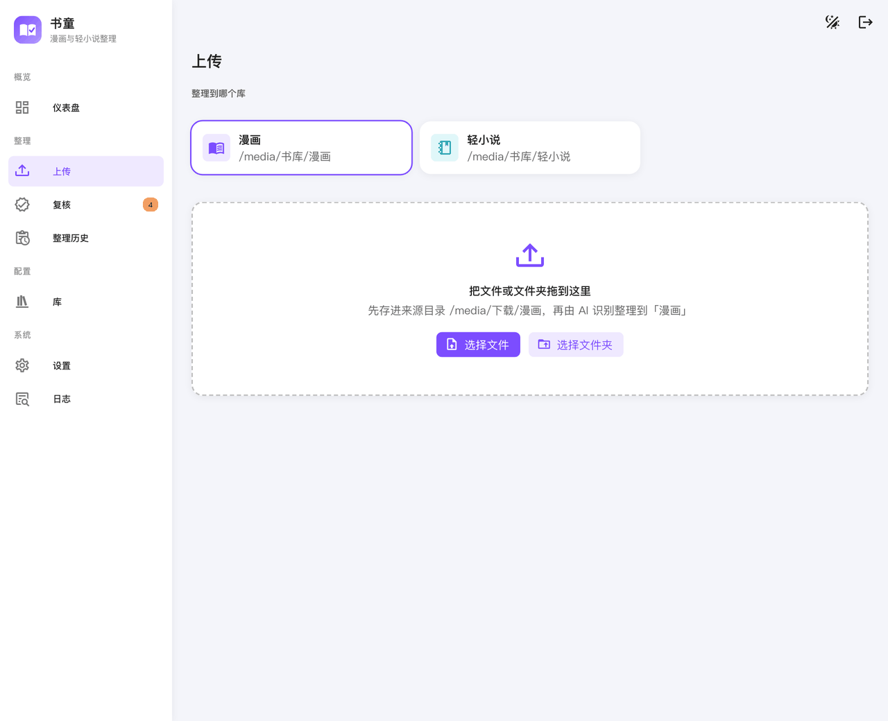

- **扫描：** 在「库」页点库的「扫描」，整理来源目录里的新文件。
- **上传：** 在「上传」页选库，把文件或文件夹拖进去。
- **桌面版拖入：** 把文件或文件夹直接拖进窗口，选放进漫画库还是轻小说库。原文件会留在原处，确认整理结果没问题后，可以按提示把原文件移进回收站。

支持的格式：漫画是 zip、cbz、rar、cbr、7z、cb7、pdf 和图片文件夹；轻小说是 epub。

整理时，书童用 AI 认出书名、版本和卷号，到元数据源查资料，把资料写进文件（漫画写 ComicInfo.xml，轻小说写 EPUB 元数据），再按命名模板放进媒体库目录。AI 有把握的直接入库，没把握的进「复核」。

**同一个目录尽量只放一部作品。** 一个目录放了几部作品时，AI 也能分开，但更容易进复核。

整理的结果在「仪表盘」能看到概况：各库的系列数、已整理和待复核的数量，以及近期整理了什么。

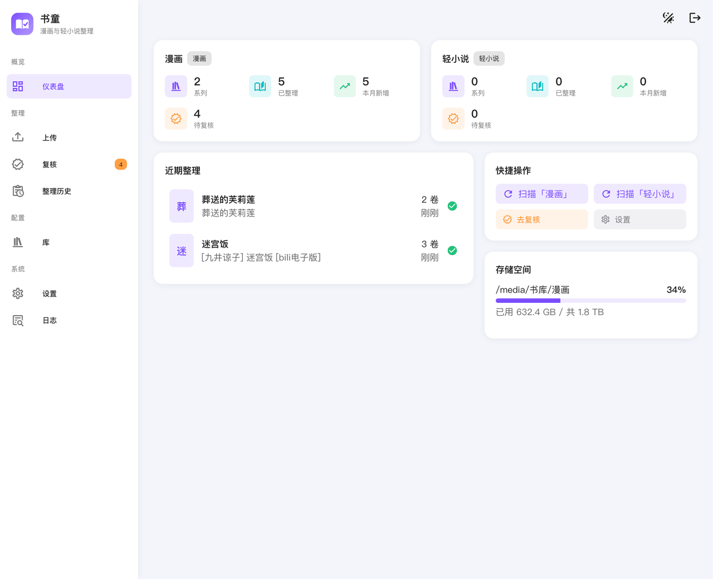

## 4. 复核

「复核」页按来源目录分组，每组右上角标着进复核的原因：

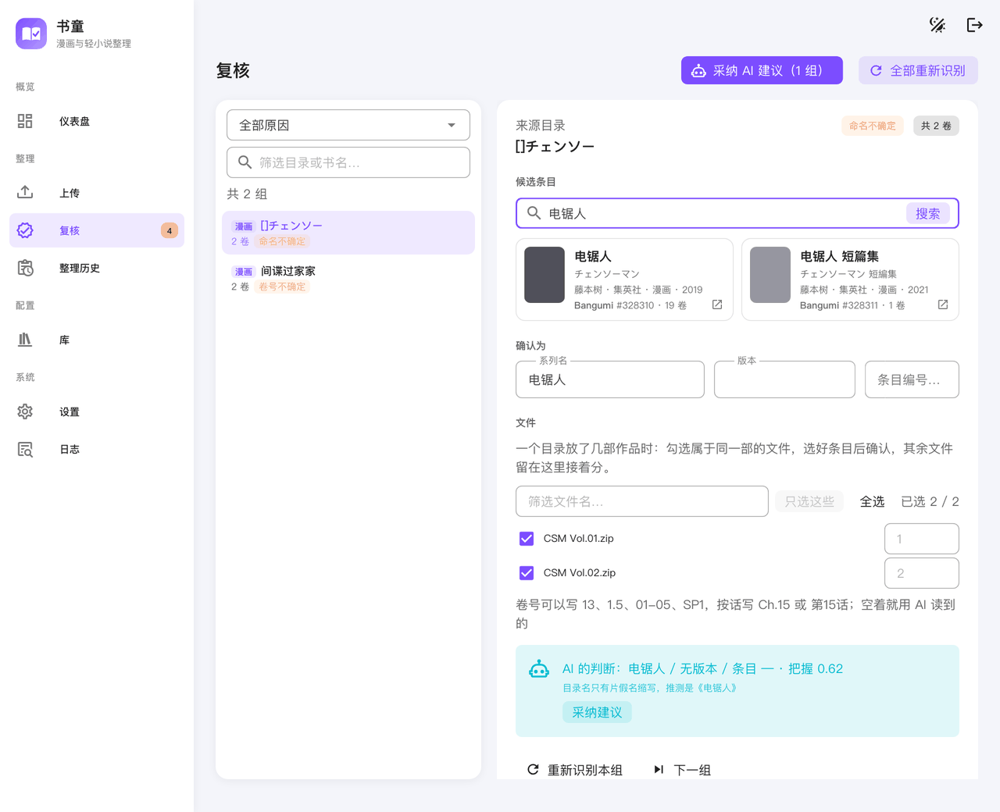

| 原因 | 怎么处理 |
|------|---------|
| 命名不确定 | AI 对书名没把握：确认或改一下书名，或者直接从候选里选一个条目 |
| 卷号不确定 | AI 对卷号没把握：在每个文件右边填卷号，如 `13`、`1.5`、`01-05`（合订）、`SP1`（番外）、`Ch.15`（单话，漫画） |
| 无元数据匹配 | 没找到条目或拿不准：从候选里选一个，或者自己搜 |
| 冲突 | 目标位置已经有文件：看一下是不是重复的卷 |

- **选条目：** 在搜索框搜书名，或者直接粘贴 Bangumi / AniList 的条目链接。开了多个数据源时，搜索框前可以选在哪个源里搜。
- **只确认一部分：** 一个目录里有几部作品时，勾选属于同一部的文件，选好条目后确认，其余文件留在这里接着处理。
- **不要元数据：** 实在找不到条目时，点「跳过识别，直接整理」，按填好的书名入库，不带简介、作者等资料。
- **重新识别本组：** 让 AI 再认一次这一组，比如刚调整过 AI 设置之后。
- **采纳 AI 建议（N 组）：** 页面右上角的按钮，一次确认列表里所有「AI 给了建议、而且建议能解决问题」的组，比如 AI 给出了书名的「命名不确定」组。可以先用左边的原因和关键字筛选，只采纳筛出来的组。卷号不确定和冲突的组要逐个处理，不在其中。

卷号不确定时，在每个文件右边填卷号；输入框里的灰字是 AI 的猜测，空着就用它：

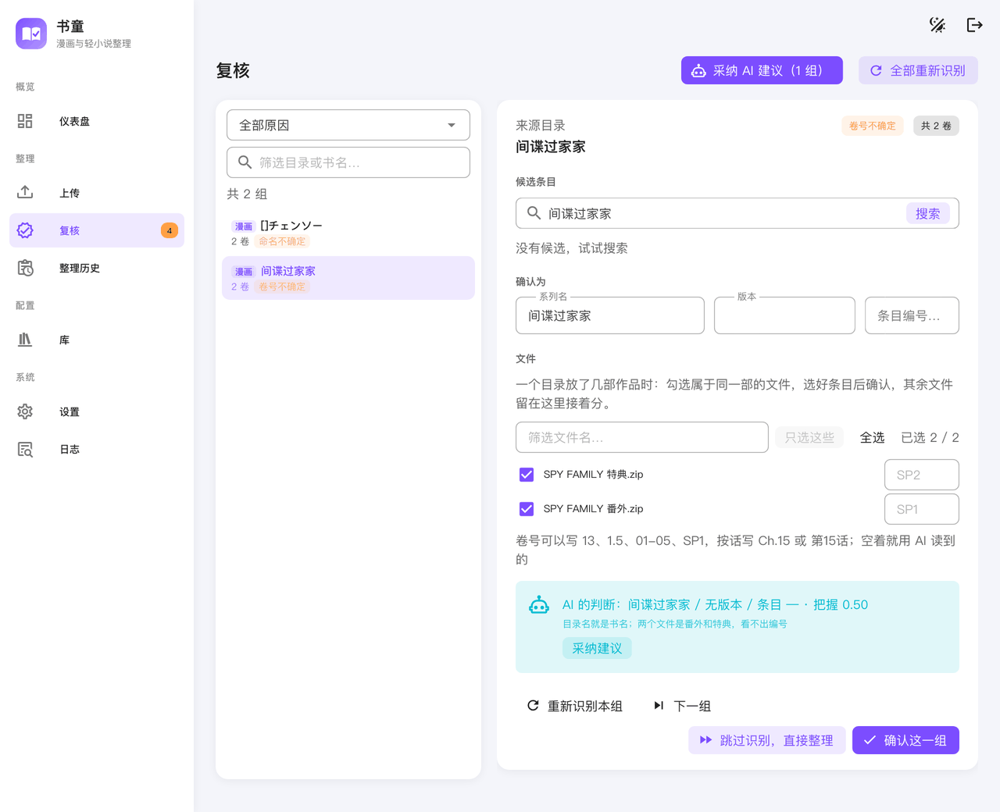

复核时做的选择会记在这些文件上，以后重新识别也会沿用。

## 5. 整理历史

「整理历史」按目录列出所有整理过的文件。点开一组可以：

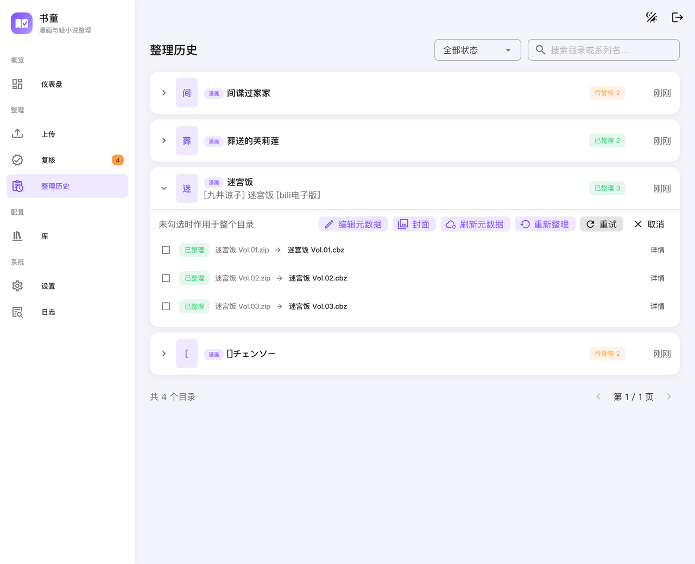

- **重新整理：** 改书名、版本、条目或卷号后重新整理。库里的旧文件会被删除（桌面版移进回收站），再按新的结果入库。需要来源文件还在且没有变过。
- **编辑元数据：** 换一个条目，或者手动填写简介、作者等。只改文件里的元数据，不重新打包，来源文件不在也能改。
- **封面：** 选某一页当封面，或者把书衣长图裁出正面。
- **重试：** 整理出错的条目可以重试。

**抽查整理结果：** 右上角的状态筛选里有几项专门用来抽查：

- **AI 选的条目：** 条目是 AI 从几个候选里挑出来的，不是书名完全一致自动匹配的，最值得看一眼。
- **来自 Bangumi / 来自 AniList：** 按数据源筛选。
- **缺元数据：** 整理了但没有条目的文件。

在「库」页还可以对整个库「刷新元数据」：重新向各自的数据源查询，只改有变化的文件。手动填过元数据的不会被覆盖。

## 6. 命名模板

整理后的文件放在哪、叫什么，由库设置里的「命名模板」决定。留空就用默认模板：

```
{series}/{series} {volume}{ext}      →  迷宫饭/迷宫饭 Vol.01.cbz
```

默认不带版本，同一部作品的不同版本（如东立版、bili 版）放在同一个系列里。

### 变量

| 变量 | 含义 | 例子 |
|------|------|------|
| `{series}` | 系列名 | 迷宫饭 |
| `{edition}` | 版本（只有漫画有） | bili电子版 |
| `{author}` | 作者（取第一位；查不到时是「未知作者」） | 九井谅子 |
| `{volume}` | 卷号 | Vol.01 |
| `{year}` | 出版年份 | 2014 |
| `{title}` | AI 认出的书名 | 迷宫饭 |
| `{bgm}` | Bangumi 条目编号 | 133315 |
| `{ext}` | 扩展名，模板必须以它结尾 | .cbz |

### 写法

- `/` 分隔目录层级。
- `{变量:格式}`：变量有值时输出格式，格式里的 `%s` 换成变量的值；变量没有值时整段省略。比如 `{edition:[%s]}` 在有版本时输出 `[bili电子版]`，没有版本时什么也不输出。

### 常用模板

```
{series}{edition:[%s]}/{series}{edition:[%s]} {volume}{ext}   →  迷宫饭[bili电子版]/迷宫饭[bili电子版] Vol.01.cbz
{author}/{series}/{series} {volume}{ext}                        →  九井谅子/迷宫饭/迷宫饭 Vol.01.cbz
{series}{year: (%s)}/{series} {volume}{ext}                     →  迷宫饭 (2014)/迷宫饭 Vol.01.cbz
{series}/{volume}{ext}                                          →  迷宫饭/Vol.01.cbz
```

在库设置的命名模板框里改模板时，下方会用这个库最近整理过的文件预览效果：

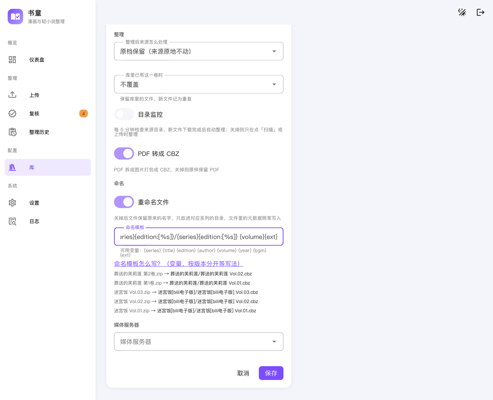

### 注意

- **想按版本分开就写 `{edition}`。** 模板里写了 `{edition}`，不同版本会分成不同的系列，Kavita、Komga 里也一样；没写就合在一起。
- **关掉「重命名文件」时，** 模板只决定放进哪个目录，文件保留原名。
- **改模板只影响之后整理的文件。** 已经整理好的，要在「整理历史」里重新整理才会按新模板放。

## 7. 联动 Kavita / Komga

整理完可以通知媒体服务器扫描，新书马上就能看到。

1. 「设置 → 媒体服务器」里点「添加媒体服务器」，选 Kavita 或 Komga，填地址、用户名（Komga 填邮箱）和密码，保存后点「测试连接」。
2. 在库设置的「媒体服务器」里选这台服务器和对应的库。

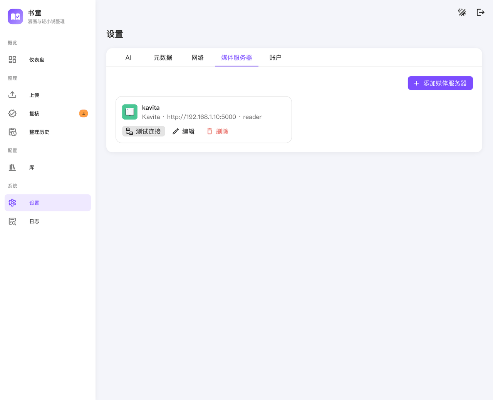

整理、重新整理、编辑元数据之后，书童会让服务器扫描对应的库并刷新改动过的系列。

> Komga 默认会「在系列标题中添加卷号」，书名会显示成「迷宫饭 (2)」这样。不想要的话，在 Komga 的库设置里关掉这一项。

## 8. 常见问题

**整理后原文件还在，占双倍空间？**
默认「原档保留」，原文件不动。确认没问题后可以手动删除，或者把库的「整理后来源怎么处理」改成移走或删除。桌面版整理完会提示把原文件移进回收站。

**条目一直停在「元数据待重试」？**
元数据源暂时连不上。检查网络或代理，之后在「整理历史」里重试，或者等下次扫描。

**书名认错了？**
在「整理历史」里重新整理，填对书名或选对条目。这个选择会记住，以后不会再认错。

**同一部作品被分成了两个系列？**
多半是两次认出的书名写法不同，或者模板里写了 `{edition}` 而两批文件版本不同。在「整理历史」里把其中一组重新整理成同一个书名即可。

**日志在哪？**
「日志」页可以直接看。桌面版也可以在菜单「帮助 → 打开日志目录」里找到。
